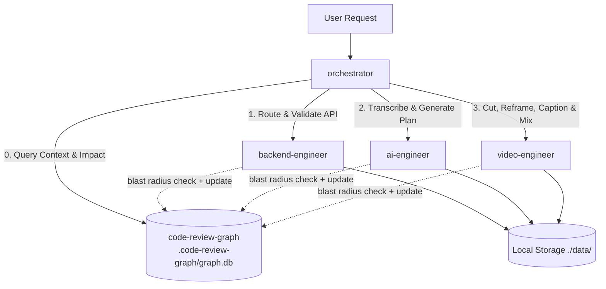

# Multi-Agent Architecture & Skills Guide

This directory defines the agent and skill infrastructure powering the **Local AI Video Editor** backend.

---

## 🤖 Agents Directory

| Agent | Scope | Subagent? | Assigned Skills |
| :--- | :--- | :---: | :--- |
| **`orchestrator`** | Master pipeline coordinator. Decomposes user goals and delegates to subagents. | No (Primary) | `code-review-graph`, `backend-engineer`, `video-editing`, `auto-editor`, `remotion-motion-graphics`, `ai-engineer` |
| **`ai-engineer`** | Speech-to-text (`faster-whisper`), LLM edit planning, and prompt-to-schema validation. | Yes | `code-review-graph`, `ai-engineer`, `auto-editor` |
| **`backend-engineer`** | FastAPI endpoints, async worker queue, SSE progress streams, and file storage. | Yes | `code-review-graph`, `backend-engineer`, `video-editing`, `ai-engineer` |
| **`video-engineer`** | FFmpeg filtergraphs, silence removal, punch-in zooms, ASS captions, and audio ducking. | Yes | `code-review-graph`, `video-editing`, `auto-editor`, `remotion-motion-graphics` |

---

## 🛠️ Specialized Skills in `.agents/skills/`

1. **`video-editing`**: Production FFmpeg command generation, filtergraph chaining, timeline assembly, and audio mixdowns.
2. **`auto-editor`**: Automatic silence removal, pacing adjustment, audio thresholding, and Whisper-assisted word cuts.
3. **`remotion-motion-graphics`**: Motion graphics, animated lower-thirds, title badges, and kinetic typography.
4. **`backend-engineer`**: FastAPI route controllers, Pydantic data modeling, error boundaries, and background job handling.
5. **`ai-engineer`**: Prompt engineering, structured JSON schema enforcement (`EditPlan`), and Whisper word timestamp processing.
6. **`code-review-graph`**: Structural codebase intelligence — dependency analysis, blast radius / impact detection, execution flow tracing, and dead code detection backed by the SQLite knowledge graph (`.code-review-graph/graph.db`).

---

## 🧭 Context Protocol: `code-review-graph` First

All agents **must** use the `code-review-graph` skill as the primary source of structural context about this codebase — before falling back to broad repository-wide greps or file scans.

### Before Making Changes
- Query the existing codebase graph (`.code-review-graph/graph.db`) for architecture, imports, callers, and execution flows before touching code:
  ```bash
  python -m code_review_graph status
  ```
- Identify all dependent components and callers before modifying shared utilities (e.g., `EditPlan` schemas, pipeline stages, storage helpers).
- Prefer graph symbol-reference lookups over repository-wide globbing/grepping when the graph already indexes the answer.

### After Making Changes
- Analyze the change impact (blast radius) and potential regressions:
  ```bash
  python -m code_review_graph detect-changes --brief
  ```
- Re-index the graph so subsequent agent turns and peer subagents see the latest state:
  ```bash
  python -m code_review_graph update
  ```

### Key Commands

| Command | Purpose |
| :--- | :--- |
| `python -m code_review_graph status` | Show total nodes, edges, indexed files, and graph statistics. |
| `python -m code_review_graph update` | Incrementally re-parse changed files and update the SQLite index. |
| `python -m code_review_graph detect-changes --brief` | Blast radius and risk summary for recent edits. |
| `python -m code_review_graph dead-code` | Identify potentially unused functions and components. |
| `python -m code_review_graph build` | Full re-build of the codebase knowledge graph. |

---

## 🔄 Orchestration Flow



