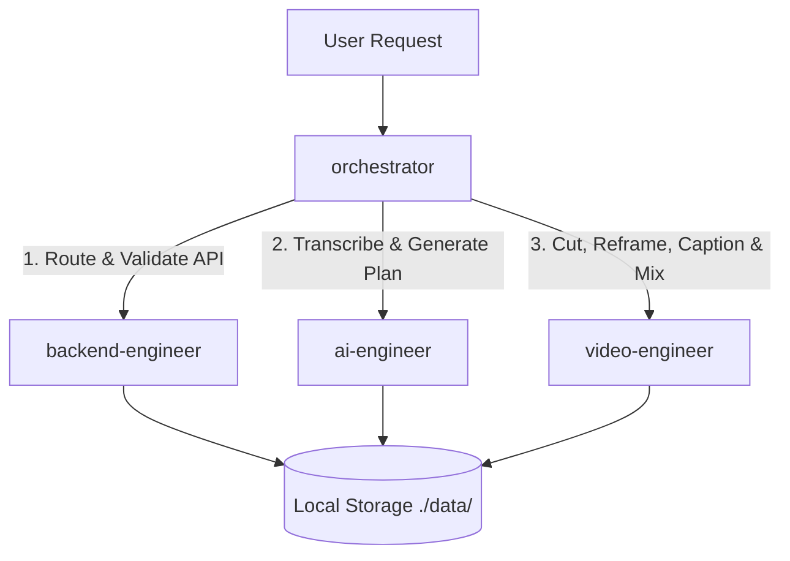

# Multi-Agent Architecture & Skills Guide

This directory defines the agent and skill infrastructure powering the **Local AI Video Editor** backend.

---

## 🤖 Agents Directory

| Agent | Scope | Subagent? | Assigned Skills |
| :--- | :--- | :---: | :--- |
| **`orchestrator`** | Master pipeline coordinator. Decomposes user goals and delegates to subagents. | No (Primary) | `backend-engineer`, `video-editing`, `auto-editor`, `remotion-motion-graphics`, `ai-engineer` |
| **`ai-engineer`** | Speech-to-text (`faster-whisper`), LLM edit planning, and prompt-to-schema validation. | Yes | `ai-engineer`, `auto-editor` |
| **`backend-engineer`** | FastAPI endpoints, async worker queue, SSE progress streams, and file storage. | Yes | `backend-engineer`, `video-editing`, `ai-engineer` |
| **`video-engineer`** | FFmpeg filtergraphs, silence removal, punch-in zooms, ASS captions, and audio ducking. | Yes | `video-editing`, `auto-editor`, `remotion-motion-graphics` |

---

## 🛠️ Specialized Skills in `.agents/skills/`

1. **`video-editing`**: Production FFmpeg command generation, filtergraph chaining, timeline assembly, and audio mixdowns.
2. **`auto-editor`**: Automatic silence removal, pacing adjustment, audio thresholding, and Whisper-assisted word cuts.
3. **`remotion-motion-graphics`**: Motion graphics, animated lower-thirds, title badges, and kinetic typography.
4. **`backend-engineer`**: FastAPI route controllers, Pydantic data modeling, error boundaries, and background job handling.
5. **`ai-engineer`**: Prompt engineering, structured JSON schema enforcement (`EditPlan`), and Whisper word timestamp processing.

---

## 🔄 Orchestration Flow

